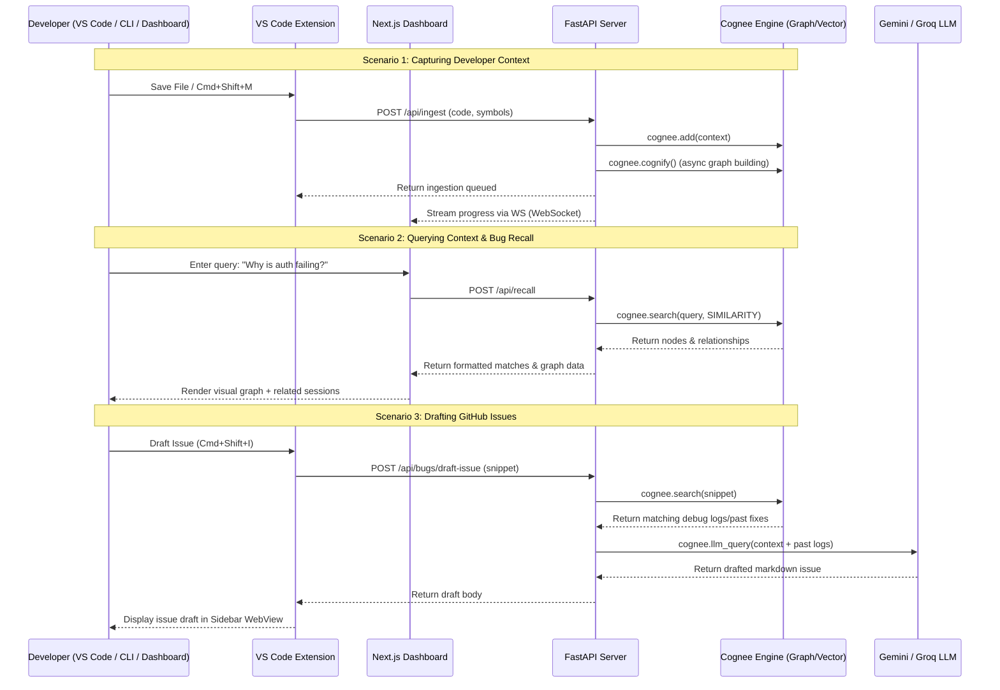

# dev·context — AI Memory for Developer Workflows

> A full-stack developer context engine that captures your coding sessions, builds semantic knowledge graphs, and resolves related debugging memory. Built for the [The Hangover Part AI Hackathon](https://www.wemakedevs.org/hackathons/cognee) | Track 1: Best Use of Cognee Open Source

---

## 🔗 Live Demo Links

* **Deployed Frontend (Vercel):** https://dev-context-cognee.vercel.app/
* **Deployed Backend (Render):** https://dev-context-cognee.onrender.com

---

[](#)
[](#)
[](#)

dev·context is a full-stack developer context engine that captures your coding sessions, ingests them into Cognee's knowledge graph, and surfaces relevant memory exactly when you need it — across debugging, bug triage, and open-source contribution.


<p align="center">
  <a href="./assets/graph.gif">Watch the demo video</a>
</p>

## 🚀 One-Click Quick Start (Local Demo)

To boot the entire persistent-memory developer context engine with seeded mock data, run these two commands in your terminal:

```bash
cp .env.example .env
docker compose up --build
```

> [!IMPORTANT]
> Please ensure you populate the `NEXTAUTH_SECRET` and `DASHBOARD_PASSWORD` inside your new `.env` file, as our production-grade security middleware will explicitly block runtime execution if they are missing.

---

## What it does

| Workflow | How Cognee is used |
|---|---|
| **Save context** | Active file + symbols → `cognee.add()` + `cognee.cognify()` |
| **Recall similar bugs** | Code snippet → `cognee.search(SIMILARITY)` returns related past sessions |
| **Draft GitHub issue** | Snippet + error → Cognee recall + `cognee.llm_query()` → structured issue body |
| **Memory graph** | Visual knowledge graph of files, functions, bugs, sessions via `cognee.get_graph()` |
| **Forget** | Remove any memory node on demand via `cognee.delete()` |
| **Live stream** | WebSocket pushes Cognee memory events (stored, recalled, forgotten) in real time |

---

## Architecture & Data Flow



---

## Project Structure

```text
dev-context-cognee/
├── backend/
│   ├── app/
│   │   ├── main.py                  # FastAPI app, all routers registered
│   │   ├── cognee_utils.py          # remember/recall/forget/memify wrappers
│   │   ├── file_watcher.py          # watchdog-based auto-ingest on file save
│   │   ├── mcp_server.py            # MCP tool server (Cognee recall as MCP tool)
│   │   ├── api/                     # Route handlers
│   │   │   ├── ingest.py
│   │   │   ├── recall.py
│   │   │   ├── bugs.py
│   │   │   ├── sessions.py
│   │   │   ├── context.py
│   │   │   ├── graph.py
│   │   │   ├── stats.py
│   │   │   ├── lifecycle.py
│   │   │   ├── contribute.py
│   │   │   └── ws.py
│   │   ├── services/
│   │   │   ├── ingest_service.py
│   │   │   ├── recall_service.py
│   │   │   └── bug_service.py       # Cognee recall + LLM → GitHub issue draft
│   │   ├── models/
│   │   │   ├── ingest.py
│   │   │   └── session.py
│   │   └── core/
│   │       ├── cognee_client.py     # init_cognee() + provider config
│   │       ├── config.py            # pydantic-settings config
│   │       ├── database.py          # SQLAlchemy engine + Base
│   │       ├── graph_builder.py
│   │       ├── github_utils.py
│   │       └── ws_manager.py
│   ├── Dockerfile
│   ├── requirements.txt
│   └── .env.example
├── extension/
│   ├── src/
│   │   ├── extension.ts             # activate() entry point
│   │   ├── provider.ts              # Sidebar WebView (full UI)
│   │   ├── commands/
│   │   │   ├── rememberContext.ts
│   │   │   ├── recallBugs.ts
│   │   │   └── draftIssue.ts
│   │   └── utils/
│   │       ├── apiClient.ts         # HTTP client with retry + 401 handling
│   │       ├── languageDetector.ts  # VS Code languageId → parse profile
│   │       └── tokenManager.ts      # SecretStorage read/write for API key
│   └── package.json
├── frontend/                        # Next.js dashboard
├── cli/
│   └── cognee_cli.py               # stdin → Cognee ingestion
├── mcp/                             # MCP server module
└── docker-compose.yml
```

---

## Quick Start

### Option A — Docker (recommended for demo)

```bash
git clone https://github.com/yashhh-23/dev-context-cognee.git
cd dev-context-cognee
cp backend/.env.example backend/.env
# Fill in your keys (see Environment Variables section below)
docker-compose up --build
```

| Service | URL |
|---|---|
| API + docs | http://localhost:8000/docs |
| Dashboard  | http://localhost:3000 |
| WebSocket  | ws://localhost:8000/ws |

### Option B — Manual

```bash
git clone https://github.com/yashhh-23/dev-context-cognee.git
cd dev-context-cognee
```

**For macOS / Linux:**
```bash
cp backend/.env.example backend/.env
python3 -m venv venv
source venv/bin/activate
```

**For Windows (CMD/PowerShell):**
```cmd
copy backend\.env.example backend\.env
python -m venv venv
venv\Scripts\activate
```

```bash
# 1. Backend
cd backend
pip install -r requirements.txt
cd ..
# Install the CLI client globally (editable mode)
pip install -e .
cd backend
uvicorn app.main:app --reload --port 8000

# 2. Frontend (separate terminal)
cd frontend
npm install
npm run dev                 # runs on http://localhost:3000
```

### VS Code Extension

```bash
cd extension
npm install
npm run compile
# In VS Code: press F5 to launch Extension Development Host
# Or package it: npm run package → installs the generated .vsix
```

On first use, run **Dev-Context: Set Cognee API Key** from the Command Palette (`Cmd/Ctrl+Shift+P`). The key is stored in VS Code SecretStorage — never in plain settings.

### MCP (Model Context Protocol) Server

To register Cognee memory tools with Claude Desktop, Cursor, or Cline:

```bash
# Run the auto-installer to register the MCP server with Claude Desktop
python mcp/install.py
```

For detailed configurations, see the `./mcp/README.md` guide.

---

## Environment Variables

Copy `.env.example` to `.env` in the root (or `backend/.env.example` to `backend/.env` for manual setups) and fill in the values below:

```env
# ── Required LLM / Cognee ───────────────────────────────────────────────
GEMINI_API_KEY=your_gemini_key_here          # Primary LLM provider
GROQ_API_KEY=your_groq_key_here              # Fallback provider

# ── GitHub Integration ──────────────────────────────────────────────────
GITHUB_TOKEN=your_github_pat_here            # Personal access token with repo scope
GITHUB_REPO=owner/repo-name                  # Target repo (e.g. yashhh-23/dev-context-cognee)

# ── App Auth & Dashboard ────────────────────────────────────────────────
NEXTAUTH_SECRET=replace-with-a-long-random-secret # Required for frontend auth cookie
DASHBOARD_PASSWORD=change-me-in-production         # Password for logging into the dashboard

# ── Storage & App Settings ──────────────────────────────────────────────
DATABASE_URL=sqlite:///./dev_context.db      # Database URL for dashboard sessions
ENABLE_BACKEND_ACCESS_CONTROL=false          # Enable backend authorization checks
CACHING=false                                # Enable caching for API requests
```

> [!NOTE]
> When running with **Docker Compose**, these values are loaded from the root `.env` and automatically mapped to both `frontend` and `backend` services. Make sure `NEXTAUTH_SECRET` and `DASHBOARD_PASSWORD` are set before booting!

---

## Cognee Memory Lifecycle

```text
Capture  →  cognee.add()        store raw context (file + symbols)
         →  cognee.cognify()    build knowledge graph (async, background)

Query    →  cognee.search()     vector + graph recall by similarity
         →  cognee.get_graph()  full node/edge map for visualisation

Manage   →  cognee.delete()     forget a specific memory node
         →  cognee.add()        memify — store manual note/context
         →  cognee.llm_query()  LLM call through Cognee's configured provider
```

---

## Development & Planning Notes

<details>
<summary>Tooling & Assistive Technologies</summary>

To accelerate research and construction during the hackathon, we leveraged advanced developer tooling:
- **Perplexity:** Utilized for planning, search, library analysis, and architectural research.
- **Google Gemini:** Leveraged for backend pipeline development, SQLite integration, and chunking logic.
- **Anthropic Claude:** Leveraged for frontend UI styling, component structures, and Next.js routing.
</details>

---

## Keybindings (VS Code Extension)

| Action | Mac | Windows/Linux |
|---|---|---|
| Save current context | `Cmd+Shift+M` | `Ctrl+Shift+M` |
| Recall similar bugs | `Cmd+Shift+R` | `Ctrl+Shift+R` |
| Draft GitHub issue  | `Cmd+Shift+I` | `Ctrl+Shift+I` |

---

*Built with [Cognee](https://github.com/topoteretes/cognee) — memory infrastructure for AI.*